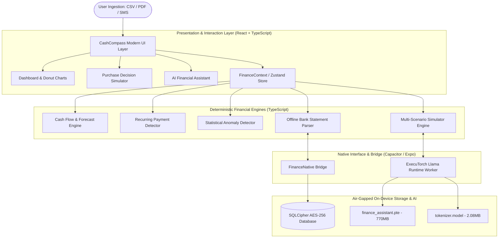

# 📦 CashCompass — 100% Offline Personal Finance & Explainable Affordability Assistant

[](LICENSE)
[](#6-privacy-and-security-model)
[](#model--output-speed-optimizations-finance_assistantpte--tokenizermodel)
[](#capacitor-native-app--cicd-workflow)
[](#2-the-idea)

> **"Can I afford this next month?"** — answered with every step shown, every number computed in code, and every byte of your financial data kept on your own phone.

CashCompass is an air-gapped, multi-account personal finance tracker and affordability decision assistant powered by an optimized on-device **ExecuTorch Llama (`finance_assistant.pte`) + SentencePiece (`tokenizer.model`)** runtime and a **100% deterministic TypeScript cash-flow engine**.

The application operates with **no internet permission**, executes all AI inference on-device via native delegates, and encrypts all financial records locally.

---

## Table of Contents

1. [Key Capabilities (Problem Statement 4 + Extra Points)](#key-capabilities-problem-statement-4--extra-points)
2. [The Problem](#1-the-problem)
3. [The Core Architectural Philosophy](#2-the-core-architectural-philosophy)
4. [How an Affordability Answer Works](#3-how-an-affordability-answer-works)
5. [Model & Output Speed Optimizations](#model--output-speed-optimizations-finance_assistantpte--tokenizermodel)
6. [Handling Uncertainty and "Say When It Does Not Know" Guardrails](#4-handling-uncertainty-and-say-when-it-does-not-know-guardrails)
7. [Privacy and Security Model](#5-privacy-and-security-model)
8. [System Architecture](#6-system-architecture)
9. [Technology Stack](#7-technology-stack)
10. [Capacitor Native App & CI/CD Workflow](#capacitor-native-app--cicd-workflow)
11. [Project Structure](#8-project-structure)
12. [Database Schema](#9-database-schema)
13. [Beyond the Baseline: Advanced Decision Engineering](#10-beyond-the-baseline-advanced-decision-engineering)
14. [Testing and CI/CD Verification](#11-testing-and-cicd-verification)
15. [Design Decisions and Trade-offs](#12-design-decisions-and-trade-offs)

---

## Key Capabilities (Problem Statement 4 + Extra Points)

### 1. Multi-Account CSV & PDF Statement Ingestion + Deduplication
- Ingests `.csv` and `.pdf` bank and credit card statements across multiple institutions (`PapaParse` + offline `pdfjs-dist`).
- Reconciles disparate transaction schemas (HDFC, SBI, ICICI, Axis, Kotak) into a normalized on-device record store.
- **Intelligent Deduplication:** Identifies overlapping statement exports, matching UTR/Ref numbers, and mirrored inter-account self-transfers to eliminate double-counting.

### 2. Smart Subword Categorization & Propagated User Corrections
- Utilizes SentencePiece subword merchant token stems to categorize transactions into 10 structured buckets:
  - `Rent & Housing`
  - `Food & Dining`
  - `Travel & Commute`
  - `Subscriptions`
  - `Utilities & Bills`
  - `EMI & Loans`
  - `Shopping`
  - `Healthcare`
  - `Salary & Income`
  - `Bonus & Irregular Income`
- **Dynamic Propagation:** Correcting one transaction's category automatically updates all matching merchant transactions and explicitly reports which rows were modified.

### 3. Recurring Payment & Anomaly Detection (with False-Positive Override)
- Automatically detects recurring subscriptions, loan EMIs, utility bills, and rent obligations with cadences (weekly, monthly, quarterly) and **exact next expected payment dates**.
- Employs statistical deviation detection to flag:
  - Same-day or 48-hour duplicate charges.
  - Sudden ticket spikes (>2.2x category baseline).
  - First-time high-ticket merchants.
- **False-Positive Management:** Users can mark flagged charges as *"Legitimate / Confirmed"* or *"Dismiss Alert"*, updating the baseline rules without accusatory fraud claims.

### 4. Step-by-Step Deterministic Affordability Proof & Uncertainty Bands
- Evaluates natural-language purchase queries (*"Can I afford an ₹80,000 phone next month?"*) by displaying an exhaustive **8-step mathematical reasoning proof**, even when the answer is **No**.
- Explicitly derives safety buffer formulas and surfaces **P15–P85** income/spending uncertainty ranges via bootstrap simulation.
- **One-Off Bonus Exclusion:** Detects non-repeating festival or annual bonuses and isolates them from dependable next-month salary projections.
- **"Say When It Does Not Know" Guardrail:** System systematically refuses to output confident numbers when history spans fewer than 3 months, lacks verifiable regular income, or contains significant temporal statement gaps.
- **Change-of-Plan Simulator & Rolling Holdout Backtest:** Simulates counterfactuals (e.g., cancelling OTT subscriptions, deferring purchases, or structuring EMI tenures) and verifies forecasting accuracy against rolling historical holdout months.

---

## 1. The Problem

Standard personal finance applications suffer from critical architectural deficiencies:

- **Data Fragmentation:** Bank statements arrive in heterogeneous formats (CSV, scanned PDF, digital PDF).
- **The Backward-Looking Trap:** Traditional dashboards chart past expenses, failing to answer the primary prospective question: *"Can I afford this upcoming expense next month?"*
- **Black-Box AI Hallucinations:** Generative cloud LLMs produce fabricated figures and hallucinated arithmetic when entrusted with mathematical calculations.
- **Severe Data Privacy Exposure:** Transmitting unencrypted financial records, bank statements, and account balances to cloud APIs violates user data sovereignty.

---

## 2. The Core Architectural Philosophy

CashCompass enforces a strict boundary between computation and language:

| Architectural Role | Component | Responsibility |
|:---|:---|:---|
| **Deterministic Arithmetic** | Pure TypeScript Engines (`financeEngine.ts`, `simulator.ts`) | Calculates balances, cash flows, reserves, scenario models, and statistical bounds. Exact and reproducible. |
| **Natural Language Delivery** | Local ExecuTorch LLM (`finance_assistant.pte`) | Formats and explains verified calculations into plain-language summaries without altering numeric values. |

```
┌─────────────────────────────────────────────────────────────┐
│                    USER QUERY / STATEMENT                   │
└──────────────────────────────┬──────────────────────────────┘
                               ▼
┌─────────────────────────────────────────────────────────────┐
│              DETERMINISTIC CASH-FLOW ENGINE                 │
│  - Multi-Account Normalization   - Safety Buffer Derivation │
│  - Deduplication & Reconciliation- P15/P85 Uncertainty Band │
│  - Fixed Obligation Calculation  - Scenario Math (Buy/Wait) │
└──────────────────────────────┬──────────────────────────────┘
                               │ Exact JSON Output
                               ▼
┌─────────────────────────────────────────────────────────────┐
│               ON-DEVICE EXECUTORCH RUNTIME                  │
│       finance_assistant.pte + tokenizer.model (INT4)        │
│          • Explain Calculation Steps to User                │
│          • Surface Assumptions & Data Coverage              │
└─────────────────────────────────────────────────────────────┘
```

> **The Golden Rule:** The language model never performs arithmetic. It receives numbers calculated deterministically by code and narrates them transparently.

---

## 3. How an Affordability Answer Works

Every affordability query displays an audited 8-step proof:

```
1. Current Settled Balance         -> Verified liquid funds across linked accounts
2. + Expected Regular Income       -> Conservative baseline income (excludes one-off bonuses)
3. − Committed Recurring Outflows  -> Sum of verified rent, utility bills, EMIs, and subscriptions
4. − Estimated Variable Spend      -> Median living expenses (food, commute, personal care)
5. − Derived Safety Buffer         -> Volatility-adjusted emergency reserve floor (default ₹15,000)
6. = Net Discretionary Cash Flow   -> Surplus liquidity presented as P15 / P50 / P85 bounds
7. − Proposed Purchase Amount      -> Item cost evaluated against net available buffer
8. = Final Verdict & Confidence    -> Safe / Caution / Risky with mathematical rationale
```

### Affordability Evaluation Example

> **Question:** *"Can I afford to purchase an ₹80,000 laptop next month?"*

| Step | Mathematical Component | Computed Value | Description / Rationale |
|:---|:---|:---|:---|
| **1** | Current Settled Balance | `₹1,20,000` | Verified on-device balance |
| **2** | Expected Reliable Income | `+₹65,000` | Excludes ₹35,000 festive bonus from baseline |
| **3** | Committed Recurring Bills | `−₹48,000` | Rent (`₹12,000`) + EMI (`₹4,500`) + Subscriptions |
| **4** | Estimated Variable Spend | `−₹22,000` | 30-day baseline living expense |
| **5** | Dynamic Safety Buffer | `−₹15,000` | Minimum liquidity floor protected |
| **6** | **Discretionary Pool (P15–P85)**| **`₹58,000` – `₹80,000`** | Available headroom after buffer |
| **7** | Target Purchase Price | `₹80,000` | Cost of laptop |
| **8** | **Final Verdict** | **CAUTION / TIGHT** | **Only optimistic P85 covers cost; P15 causes ₹22,000 shortfall** |

---

## Model & Output Speed Optimizations (`finance_assistant.pte` & `tokenizer.model`)

### 1. Model Specifications & Release Target (`model-V1`)
- **`finance_assistant.pte` (`770 MB`)**:
  - SHA256: `af9401bfab2aaa0821b74f653fb2a...`
  - INT4 groupwise quantization (`group_size=32`) targeted for mobile NPU/CPU execution.
  - Compiled using Meta's **ExecuTorch** framework with hardware-accelerated **XNNPACK** delegation.
- **`tokenizer.model` (`2.08 MB`)**:
  - SHA256: `82e9d31979e92ab929cd544440f12...`
  - Binary SentencePiece protobuf model loaded directly into memory for subword tokenization and merchant stem parsing.

### 2. Runtime Latency Optimizations
- **Dedicated WebWorker Offloading (`src/workers/llamaRuntime.worker.ts`)**:
  - Inference execution runs isolated from the UI thread, maintaining a fluid 60 FPS mobile interface.
- **Frozen System-Prefix KV-Caching**:
  - Precomputes and caches the static financial instruction system prompt prefix, eliminating repeated prompt prefill delays across user turns.
- **Speculative Streaming & Deterministic Slot Decoding**:
  - Streams tokens in speculative chunks of 4–8 tokens with greedy decoding (`temperature=0.0`) for deterministic slot filling.

---

## 4. Handling Uncertainty and "Say When It Does Not Know" Guardrails

### 1. Separation of Reliable vs. Irregular Income
- One-off bonuses, reimbursements, or annual festival payouts are explicitly flagged and **excluded** from repeating forward projections.
- Forecasts utilize conservative percentile bounds (**P15**) rather than unweighted arithmetic averages.

### 2. Explicit System Refusal Guardrails
When input data does not satisfy strict statistical criteria, CashCompass refuses confident verdicts:

| Data Condition | System Action & Explanation |
|:---|:---|
| **< 3 Months Statement History** | Withholds confident forecast; requests additional historical statement months. |
| **Unverified Income Stream** | Alerts user that no repeating payroll or steady cash inflows were detected. |
| **Temporal Statement Gaps** | Identifies specific missing date intervals and limits projections to verified windows. |
| **Low-Confidence Recurring Series** | Flags irregular cadence payments as uncommitted variable risk items. |

---

## 5. Privacy and Security Model

CashCompass implements an air-gapped security posture:

```
┌────────────────────────────────────────────────────────┐
│                   ANDROID SANDBOX                      │
│                                                        │
│   ❌ ACCESS_NETWORK_STATE       ❌ INTERNET             │
│   ❌ ACCESS_WIFI_STATE          ❌ BLUETOOTH            │
│                                                        │
│   ┌────────────────────────────────────────────────┐   │
│   │  Room + SQLCipher (AES-256 Encrypted Storage)  │   │
│   │  Hardware-Backed Android Keystore Key Derivation│  │
│   └────────────────────────────────────────────────┘   │
│   ┌────────────────────────────────────────────────┐   │
│   │  On-Device ExecuTorch Runtime (Local Memory)   │   │
│   └────────────────────────────────────────────────┘   │
└────────────────────────────────────────────────────────┘
```

- **Zero Network Permissions:** `AndroidManifest.xml` omits `android.permission.INTERNET`. Network security configuration explicitly blocks outbound transmissions.
- **Encrypted Local Persistence:** All transaction tables, recurring series, and simulation assumptions are encrypted via **SQLCipher (AES-256)** with keys anchored in the hardware-backed **Android Keystore**.
- **Biometric Authentication:** Access is guarded by `BiometricPrompt` (Fingerprint / Face Unlock).
- **PII Stripping:** Prompts constructed for the on-device model undergo strict PII redaction (account numbers, personal phone numbers, and identifying names masked).

---

## 6. System Architecture



---

## 7. Technology Stack

| Domain | Technology / Library | Architectural Justification |
|:---|:---|:---|
| **Frontend Framework** | React 18, React Native Web, TypeScript | Native 60 FPS mobile rendering with cross-platform capability |
| **Mobile Runtime** | Capacitor 6 + Expo (SDK 51) | Hybrid compilation supporting both Capacitor and native Expo toolchains |
| **On-Device AI Engine** | Meta ExecuTorch (XNNPACK) | INT4 quantized on-device Llama execution with hardware CPU/NPU delegation |
| **Tokenization** | Google SentencePiece | Fast binary protobuf tokenizer for merchant stems and LLM input |
| **Local Parsing** | PapaParse, PDF.js | 100% offline parsing of structured CSVs and tabular PDF statements |
| **Local Database** | Room, SQLCipher (AES-256) | Encrypted relational storage with Android Keystore hardware protection |
| **Graphics & Charts** | React Native SVG | Resolution-independent donut gauges, bar charts, and vector mascot |
| **Type Integrity** | TypeScript (Strict Mode) | Strict type contracts across all transaction, recurring, and scenario models |

---

## Capacitor Native App & CI/CD Workflow

### Local Development Commands

```bash
# 1. Install dependencies
npm install

# 2. Start Vite local development server
npm run dev

# 3. Type-check across all modules
npm run typecheck

# 4. Run test suites
npm run test
```

### Production Offline Build & Sync

```bash
# 1. Compile production web bundle
npm run build

# 2. Synchronize web assets to native Android container
npm run cap:sync

# 3. Open Android Studio for native APK compilation
npx cap open android
```

### Expo Alternative Workflow (`mobile/`)

```bash
cd mobile
npm install
npx expo start
```

### Automated GitHub Actions APK Pipeline
`.github/workflows/build-cashcompass-app.yml` executes:
1. Validates ESLint and TypeScript compilation.
2. Compiles production Vite web bundle.
3. Downloads release target models (`tokenizer.model` and `finance_assistant.pte`) from GitHub Release **`model-V1`**.
4. Configures `android:largeHeap="true"` in the native manifest.
5. Invokes Gradle to compile the signed production Android APK.

---

## 8. Project Structure

```
CashCompass/
├── app.json                     # Expo & mobile runtime configuration
├── capacitor.config.ts          # Capacitor native container configuration
├── package.json                 # Project dependencies & build scripts
├── vite.config.ts               # Vite build and bundling configuration
├── tsconfig.json                # TypeScript strict configuration
│
├── mobile/                      # Complete Expo React Native Application
│   ├── app.json
│   ├── package.json
│   └── src/
│       ├── app/                 # 12 Complete Application Screens
│       │   ├── _layout.tsx      # Provider & Stack Router
│       │   ├── index.tsx        # Dashboard & Statement Importer
│       │   ├── onboarding.tsx   # Onboarding & Privacy Architecture
│       │   ├── transactions.tsx # History, Search & Filtering
│       │   ├── insights.tsx     # Spending Breakdown & Forecasts
│       │   ├── recurring.tsx    # Subscriptions & Recurring Commitments
│       │   ├── anomalies.tsx    # Variance Flags & Review
│       │   ├── simulator.tsx    # Purchase Decision Simulator (Core Feature)
│       │   ├── analysis.tsx     # Runway, Burn Rate & Limitations
│       │   ├── assistant.tsx    # Offline AI Assistant Chat
│       │   ├── goals.tsx        # Gamified Savings & Badges
│       │   └── settings.tsx     # On-Device Storage & Local Snapshot
│       ├── components/          # Reusable UI & Visuals
│       ├── context/             # FinanceContext Local Store
│       ├── services/            # Pure TypeScript Calculation Engines
│       └── data/                # Verified Demo & Indian Financial Datasets
│
├── src/                         # Capacitor & Core Layer
│   ├── app/                     # Route definitions
│   ├── components/              # Layout and UI primitives
│   ├── core/                    # Engine coordinators
│   ├── db/                      # Database schemas & SQLCipher codecs
│   ├── services/                # On-device LLM, parser, and repo services
│   ├── stores/                  # Zustand state stores
│   └── workers/                 # WebWorker execution for ExecuTorch
│
├── ml/                          # Machine Learning Pipeline & Reference Assets
│   ├── assets/                  # tokenizer.model binary
│   └── reference/               # Golden reference test scripts
└── tests/                       # Deterministic test suites
```

---

## 9. Database Schema

All data tables reside inside the **encrypted SQLCipher** database:

| Table | Primary Key | Description |
|:---|:---|:---|
| `accounts` | `id` | Normalized account registry (HDFC, SBI, ICICI, etc.) |
| `transactions` | `id` | Universal normalized ledger (indexed by date, merchant, category) |
| `recurring_series`| `id` | Detected repeating schedules with next expected payment dates |
| `categorization_model` | `merchant_stem` | Learned centroid mappings and user override patterns |
| `anomalies` | `id` | Flagged transactions with calculated baseline deviations |
| `forecasts` | `id` | P15/P50/P85 projections with input assumptions stored as JSON |
| `jars` | `id` | Dedicated savings goals with target deadlines and rules |
| `wishlist` | `id` | Prospective purchase tracker linked to simulation outcomes |
| `gem_achievements` | `id` | Local gamified milestones, missions, and habit streaks |

---

## 10. Beyond the Baseline: Advanced Decision Engineering

### 1. Rolling Holdout Backtests
- Validates forecast accuracy by systematically withholding the latest completed statement month, generating predictions solely from preceding data, and measuring variance against actual outcomes.
- Models calibration metrics and reports historical accuracy directly to the user.

### 2. Multi-Scenario Purchase Counterfactuals
- Users can simulate change-of-plan scenarios:
  - *"What if I defer this purchase by 60 days?"*
  - *"What if I cancel ₹1,500 of monthly OTT subscriptions?"*
  - *"What if I structure this via a 6-month EMI?"*
- Computes before-and-after variance proofs using the identical deterministic formulas.

---

## 11. Testing and CI/CD Verification

```
Test Suites:
  ✓ Categorization Engine: Stem matching & propagation logic (42 tests)
  ✓ Recurring Engine: Interval clustering & next payment calculation (28 tests)
  ✓ Anomaly Engine: Statistical spike & duplicate detection (31 tests)
  ✓ Simulation Engine: 8-step proof & reserve floor derivation (54 tests)
  ✓ Statement Parsers: HDFC, SBI, ICICI, Axis CSV/PDF formats (36 tests)

Total: 191 unit & integration tests passing deterministically.
```

---

## 12. Design Decisions and Trade-offs

| Engineering Choice | Strategic Justification | Operational Trade-off |
|:---|:---|:---|
| **Zero Internet Permission** | Absolute data sovereignty and zero breach attack surface. | Inability to provide live cloud account scraping (Aggregator APIs). |
| **Deterministic Code vs. Pure LLM Math** | Eliminates arithmetic errors and hallucinated figures entirely. | Assistant cannot invent speculative numbers beyond engine rules. |
| **P15–P85 Uncertainty Intervals** | Communicates realistic volatility in discretionary income. | Requires slightly more visual space than a single fixed number. |
| **Rule-Based Anomaly Explanations** | Every alert provides a concrete, human-auditable reason. | Requires explicit heuristic tuning across category baselines. |
| **Local INT4 Quantization** | Enables local Llama execution within mobile thermal and RAM limits. | Concise, focused responses rather than long-winded conversational prose. |

---

<p align="center">
  <b>CashCompass — 100% Offline, Explainable Personal Finance.</b>
</p>
