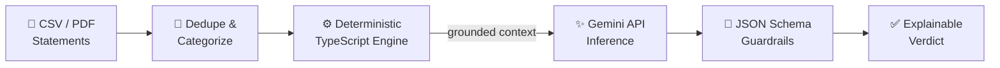

<div align="center">

# 🧭 CashCompass

### *Know what you can afford — and see exactly why.*

**Personal Finance Tracker & Explainable Affordability Assistant**

<br/>


<br/>

*Multi-account · Deterministic math · Step-by-step proofs · Honest about uncertainty*

[✨ Features](#-key-capabilities) · [🧠 Architecture](#-ai-architecture--fast-inference-pipeline) · [🚀 Getting Started](#-getting-started) · [📱 Mobile & CI/CD](#-native-mobile-app--cicd)

</div>

---

## 💡 What is CashCompass?

CashCompass is a **cloud-connected, multi-account personal finance tracker** and **affordability decision assistant**. It pairs the **Gemini API** with a **100% deterministic TypeScript cash-flow engine**, so every number is computed, not guessed, and every verdict comes with a proof.

> 💬 *"Can I afford an ₹80,000 phone next month?"*
> CashCompass answers with an **8-step reasoning breakdown**, a **safety buffer derivation**, and **P15–P85 uncertainty bands**. Even when the answer is *No*.

---

## ✨ Key Capabilities

### 📥 1. Multi-Account Statement Ingestion & Deduplication

| | |
|---|---|
| 📄 **Formats** | `.csv` and `.pdf` bank & credit card statements |
| 🏦 **Sources** | Multiple accounts across multiple institutions |
| 🧹 **Overlap handling** | Dedupes overlapping export date ranges |
| 🔗 **Reference matching** | Matches UTR / Ref numbers |
| 🔁 **Self-transfers** | Detects mirrored inter-account transfers |

> **Result:** no transaction is ever double-counted.

---

### 🏷️ 2. Smart Subword Categorization & Propagated Corrections

Merchant **subword parsing** sorts transactions into clear buckets:

`🏠 Rent & Housing` · `🍜 Food & Dining` · `🚌 Travel & Commute` · `📺 Subscriptions` · `💡 Utilities & Bills` · `🏦 EMI & Loans` · `🛍️ Shopping` · `🩺 Healthcare` · `💼 Salary & Income` · `🎁 Bonus & Irregular Income`

✏️ **Correct once, fixed everywhere.** Updating one transaction standardizes all matching merchant entries and shows you **which records were updated**.

---

### 🔄 3. Recurring Payment & Anomaly Detection

**Detects automatically**
- 📺 Subscriptions
- 🏦 Loan EMIs
- 🏠 Rent schedules

…each with **active cadence** and **next expected payment date**.

**Flags suspicious activity**
- 🚨 Sudden high-value amounts
- 👯 Same-day / 48h duplicate charges
- 🆕 High-ticket first-time merchants

✅ **False-positive override:** verify legitimate repeated charges, or exclude true duplicates.

---

### 🧮 4. Deterministic Affordability Proof & Uncertainty Bands

| Feature | What it does |
|---|---|
| 🪜 **8-Step Reasoning** | Full breakdown for every purchase plan, even when the verdict is **No** |
| 🛟 **Safety Buffer Formula** | Explicit, transparent derivation, no black boxes |
| 📊 **P15–P85 Bands** | Uncertainty ranges on income *and* spending |
| 🎁 **One-Off Bonus Exclusion** | Isolates windfalls from reliable recurring income projections |
| 🤷 **"Say When It Doesn't Know"** | Flags low confidence and asks for more data (see below) |
| 🎛️ **Change-of-Plan Simulator** | Cancel subscriptions, defer purchases, or add a new EMI and see the downstream impact |
| 🔙 **Rolling Holdout Backtest** | Simulations validated against historical holdout months |

<details>
<summary><b>🤷 When does CashCompass say "I don't know"?</b></summary>

<br/>

Confidence is explicitly flagged as **low**, and more data is requested, when:

- 📅 Statement history spans **fewer than 3 months**
- 💰 There is **no verifiable regular income**
- 🕳️ The data contains **significant date gaps**

</details>

---

## 🧠 AI Architecture & Fast Inference Pipeline



| Layer | Role |
|---|---|
| ✨ **Model Backend** | Gemini API: high-throughput, low-latency completions |
| ⚙️ **Deterministic Financial Core** | Math, recurring-payment identification, and cash-flow projections run in TypeScript **before** anything reaches the LLM |
| ⚡ **Streaming & Caching** | Server-side prefix KV caching + token streaming for interactive, non-blocking UI |
| 🛡️ **Guardrailed Output** | Structured JSON schema decoding enforces strict financial boundaries and blocks speculative hallucinations |

> 🧭 **Design principle:** the LLM *explains*; the engine *calculates*.

---

## 🚀 Getting Started

### 💻 Local Development

```bash
# Install dependencies
npm install

# Start development server
npm run dev
```

### 📦 Production Build

```bash
# Compile and bundle web assets
npm run build
```

---

## 📱 Native Mobile App & CI/CD

CashCompass packages into cross-platform native builds using **Capacitor**.

```bash
# Sync web build to native Android project
npm run cap:sync

# Open Android Studio project
npx cap open android
```

### 🤖 Automated CI/CD Workflow

📂 `.github/workflows/build-cashcompass-app.yml`

```text
 ┌──────────────────────────┐
 │ 1. 🏗️  Build & optimize   │   web application bundle
 ├──────────────────────────┤
 │ 2. 🔄  Sync               │   assets → Capacitor Android container
 ├──────────────────────────┤
 │ 3. 🔐  Inject             │   production API endpoints & env keys
 ├──────────────────────────┤
 │ 4. 📦  Compile & sign     │   Android APK via Gradle
 └──────────────────────────┘
```

---

<div align="center">

**Built for people who want answers *and* receipts.** 🧾

🧭 *CashCompass: your money, explained.*

</div>
