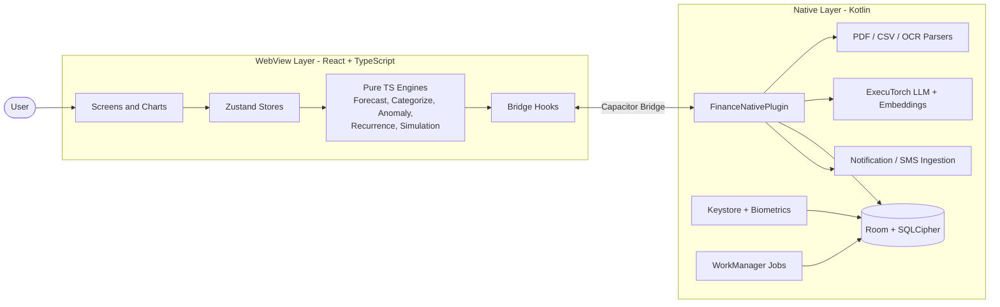

# 📦 CashCompass — Offline AI Finance Assistant

> **"Can I afford this next month?"** — answered with every step shown, every number computed in code, and every byte of your financial data kept on your own phone.

CashCompass is an Android personal-finance assistant that reads your bank statements, understands your spending, and answers affordability questions with a **transparent, checkable, step-by-step explanation**. It works **entirely offline**: the app has no internet permission, the AI model runs on the device, and the database is encrypted.

---

## Table of Contents

1. [The Problem](#1-the-problem)
2. [The Idea](#2-the-idea)
3. [Feature Overview](#3-feature-overview)
4. [How an Affordability Answer Works](#4-how-an-affordability-answer-works)
5. [Handling Uncertainty and Missing Data](#5-handling-uncertainty-and-missing-data)
6. [Privacy and Security Model](#6-privacy-and-security-model)
7. [System Architecture](#7-system-architecture)
8. [Technology Stack](#8-technology-stack)
9. [Project Structure](#9-project-structure)
10. [Database Schema](#10-database-schema)
11. [Beyond the Baseline](#11-beyond-the-baseline)
12. [Testing and CI/CD](#12-testing-and-cicd)
13. [Design Decisions and Trade-offs](#13-design-decisions-and-trade-offs)
14. [Limitations and Future Work](#14-limitations-and-future-work)

---

## 1. The Problem

Many people do not know whether they can afford something until the money is already gone.

- Bank statements arrive in different formats (CSV, PDF) from different banks.
- Spending is rarely categorized.
- Recurring payments and unusual charges are easy to miss.
- Most budgeting tools chart the **past**, but few answer the real question: **"Can I afford this next month?"**

A wrong answer can push someone into debt, so the answer must be **explainable** and **checkable**.

## 2. The Idea

CashCompass separates two jobs that are often (dangerously) mixed together:

| Job | Who does it | Why |
|---|---|---|
| **Arithmetic** — balances, forecasts, buffers, verdicts | Deterministic code (TypeScript engines) | Numbers must be exact, reproducible and auditable |
| **Language** — explaining the result, answering follow-ups in plain English | On-device LLM | Natural conversation, with no ability to alter the numbers |

> **Golden rule:** the language model never calculates. It receives numbers already computed by code and only *narrates* them.

---

## 3. Feature Overview

### 3.1 Statement Ingestion
- Accepts **CSV and PDF** statements from **multiple accounts**.
- PDF tables are extracted natively (PDFBox); scanned statements can use on-device OCR (ML Kit).
- All accounts are merged into **one unified transaction history**.
- **De-duplication:** the same transaction appearing in two files (or an overlapping date range) is detected and counted once.

### 3.2 Transaction Categorization
- Categories such as **rent, food, travel, subscriptions** and more.
- Uses on-device embeddings plus a **k-NN / centroid** model, so it learns from your own data.
- **User corrections propagate:** fix one merchant and similar transactions (e.g., same merchant) are updated too — and the app **tells you exactly which transactions it changed**.

### 3.3 Recurring Payment Detection
- Finds subscriptions, EMIs and other repeating payments by **clustering the intervals** between charges.
- Reports **amount, frequency, confidence, and next expected date**.
- A background worker reminds you of upcoming bills **two days ahead**.

### 3.4 Anomaly Detection
Rule-based and fully explainable. Each flag comes with a **plain-language reason**.

| Rule | Example reason shown to the user |
|---|---|
| **Duplicate** | "Same merchant and amount charged twice within a short window" |
| **Spike** | "This amount is far above your usual spend at this merchant/category" |
| **New merchant** | "First time this merchant appears in your history" |
| **Missing** | "A regular payment did not appear when expected" |

Users can mark a flag as *"this was legitimate"* — and the system learns from it (see [§11.3](#113-when-the-system-is-wrong)).

### 3.5 Cash-Flow Forecast
- Projects the balance for coming weeks/months from **income**, **recurring commitments**, and **average variable spending**.
- Uses **bootstrap resampling** to produce a **P10 / P50 / P90 range** rather than a single misleading number.

### 3.6 Affordability Questions
Ask in natural language — *"Can I afford an ₹80,000 phone next month?"* — and get a verdict with the **full reasoning chain** (see [§4](#4-how-an-affordability-answer-works)).

### 3.7 Dashboard
Everything important is visible **without digging through screens**:
- Spending **by category** (donut chart)
- **Monthly trend** (trend chart)
- **Forecast** with uncertainty band (cone chart)
- Plus: Sankey (net worth flows), waterfall, and heatmap views.

### 3.8 Extra Tools
- **Purchase Simulator** — "what if I cancel a subscription or take a loan?" with a before/after diff.
- **Jars** — savings goals with allocation rules and round-ups.
- **Wishlist** — items linked to jars, with affordability checks.
- **Net Worth Dashboard** — aggregated accounts with Sankey flows.
- **Gemify** — gamified streaks and badges for good financial habits.
- **Messenger Sync** — optional capture of bank notification/SMS transactions, filtered on-device.
- **Biometric lock** — fingerprint/face gate on app open.

---

## 4. How an Affordability Answer Works

Every answer — **including a "No"** — shows all of these steps:

```
1. Current balance            what you have today
2. + Expected income          from detected income, as a range
3. − Committed payments       recurring bills, EMIs, subscriptions due before the target date
4. − Estimated variable spend average discretionary spending (food, travel, etc.)
5. − Safety buffer            protection against surprises (with the reason it was chosen)
6. = Money available          shown as P10 / P50 / P90
7. vs. Purchase price         → Verdict + confidence
```

### Illustrative example (not real data)

> **Question:** Can I afford an ₹80,000 phone next month?

| Step | Value |
|---|---|
| Current balance | ₹1,20,000 |
| Expected income (P10–P90) | ₹55,000 – ₹70,000 |
| Committed payments | −₹48,000 (rent, EMI, 6 subscriptions) |
| Variable spending (P10–P90) | −₹22,000 – −₹34,000 |
| Safety buffer | −₹15,000 |
| **Available after buffer (P10 / P50 / P90)** | ₹58,000 / ₹71,000 / ₹80,000 |
| Purchase | ₹80,000 |
| **Verdict** | **Not safely — only the optimistic case covers it** |

The LLM then turns this table into a readable explanation. It cannot change a single figure.

### How the safety buffer is decided
The buffer is **derived from your own data, not a fixed guess**:
- It grows when your income or spending is **more volatile** (wider P10–P50 gap).
- It is never below a minimum floor.
- The app states the **reason** in plain words (e.g., *"Your spending varied a lot last 4 months, so the buffer is larger"*).

*(Exact parameters live in the `ForecastEngine` and are covered by unit tests.)*

---

## 5. Handling Uncertainty and Missing Data

### 5.1 Uncertain income
If income differs month to month, a single number misleads. CashCompass shows a **range** (P10 / P50 / P90) and bases the verdict on the **conservative end**, not the average.

### 5.2 Saying "I don't know"
The system **refuses to give a confident number** when the data cannot support one, and says *what is missing*:

| Situation | Behavior |
|---|---|
| **Fewer than 3 months** of statements | Declares data too short; no confident verdict |
| **No income found** | States that income could not be detected |
| **Gaps in dates** | Points out which periods are missing |
| **Low-confidence recurring items** | Marks them as uncertain in the breakdown |

An honest "I can't tell yet, because X is missing" is treated as a **correct answer**, not a failure.

---

## 6. Privacy and Security Model

Bank statements are among the most sensitive files a person owns. CashCompass answers *"what leaves the device?"* with a simple, defensible answer: **nothing**.

| Layer | Protection |
|---|---|
| **Network** | `AndroidManifest.xml` declares **no INTERNET permission**; `network_security_config.xml` **blocks all traffic** |
| **AI** | The LLM (ExecuTorch `.pte` model), tokenizer, and embedding model are **bundled with the app** and run locally |
| **Storage** | Room database encrypted with **SQLCipher**; the key is derived from **Android Keystore** (hardware-backed) |
| **Access** | **Biometric gate** on launch; key operations via BiometricPrompt |
| **Prompts** | `PromptBuilder` applies **PII redaction** before anything reaches the local LLM |
| **Notifications/SMS** | Only an **allow-list of finance apps** and **finance keywords** are processed; everything else is discarded |
| **Backups** | **AES-GCM** encrypted export/import, user-triggered |
| **Logs** | ProGuard rules **strip log statements** in release builds |

**Why fully on-device?** Sending raw statements to a cloud service creates a permanent copy outside the user's control. By eliminating the network entirely, there is no server to breach, no policy to trust, and the claim is **verifiable by inspecting the manifest**.

---

## 7. System Architecture

CashCompass has two cooperating layers connected through a Capacitor bridge.



### 7.1 WebView Layer (React + TypeScript + Capacitor)
- **Pages** – Splash, Onboarding, Upload, Dashboard, History, Insights, Recurring Center, Anomaly Center, Purchase Simulator, Simulation Details, AI Chat, Settings, Messenger Sync, Jars, Wishlist, Gemify, Net Worth.
- **Shared UI** – charts (trend, donut, Sankey, waterfall, cone, heatmap), forms, layout primitives (tabs, drawer, modal, virtual list), a Canvas/WebGL gem renderer, and accessibility wrappers (focus trap, live region).
- **State (Zustand)** – transactions, forecast, settings, biometric lock, messenger, jars, wishlist, gemify.
- **Core business logic (pure TypeScript, deterministic):**

| Engine | Responsibility |
|---|---|
| `ForecastEngine` | Bootstrap simulation, P10/P50/P90, safety buffer |
| `CategorizeEngine` | k-NN, centroid updates, correction propagation |
| `AnomalyEngine` | Duplicate, spike, new-merchant, missing-payment rules |
| `RecurrenceEngine` | Interval clustering and confidence scoring |
| `SimulationEngine` | Counterfactuals and diff view |
| `JarEngine` | Allocation rules and round-ups |
| `WishEngine` | Affordability check and jar linking |
| `GemEngine` | Streaks and badge particles |
| `NetWorthEngine` | Aggregation and Sankey data |
| `PromptBuilder` | PII redaction and context chips for the LLM |
| `Parsers` | CSV (PapaParse) and PDF (PDF.js) in the web layer |

- **Hooks** – adapters (`useSQLite`, `useLLM`, `useStatementParser`, `useEmbedding`, `useBiometric`, …) that hide the bridge from the UI.

### 7.2 Native Layer (Kotlin + Android SDK)
- **MainActivity** – biometric gate, model asset copy, Capacitor bridge host.
- **FinanceNativePlugin** – single dispatcher for LLM, embeddings, parsing, crypto, notifications and SMS.
- **Database** – Room + SQLCipher, DAO with suspend/Flow queries, migrations, Keystore-backed `EncryptionProvider`.
- **Messenger ingestion** – `NotificationListenerService` → `PrivacyFilter` → `MessageParser` (regex for amount, merchant, mask, type) → `PendingTxnBuffer`; SMS Retriever API for OTP.
- **AI subsystem** – `ExecuTorchManager` (XNNPACK delegate), `LLMInferenceEngine` (streaming, KV cache), `EmbeddingEngine`, `Tokenizer` (SentencePiece), `LoRAAdapterManager` (dynamic adapter loading).
- **File parsing** – PDFBox table extraction, CSV parser, ML Kit OCR.
- **Background workers (WorkManager)** – daily forecast refresh (03:00), bill reminders (2 days before due), user-triggered auto-backup.

---

## 8. Technology Stack

| Area | Technology |
|---|---|
| UI | React, TypeScript, Vite, Tailwind CSS |
| State | Zustand, TanStack Query |
| Mobile bridge | Capacitor |
| Native | Kotlin, Android SDK, WorkManager |
| Database | Room, SQLCipher, FTS5 (merchant search), Drizzle/SQL migrations |
| On-device AI | ExecuTorch (`.pte` models, XNNPACK), SentencePiece, QLoRA adapters |
| Parsing | PapaParse, PDF.js, PDFBox, OpenCSV/Apache POI, ML Kit OCR |
| Security | Android Keystore, BiometricPrompt, AES-GCM |
| Quality | ESLint, Vitest, Detekt, KtLint, JUnit |
| Delivery | GitHub Actions, Dependabot, Release Drafter, Git LFS (for model files) |

---

## 9. Project Structure

```
CashCompass/
├── package.json · capacitor.config.ts · vite.config.ts
├── tsconfig.json · tailwind.config.js
├── src/                         # WebView layer
│   ├── main.tsx · App.tsx       # providers, routes, biometric gate
│   ├── pages/                   # all screens
│   ├── components/              # charts, forms, layout, a11y, gemify
│   ├── stores/                  # Zustand stores
│   ├── engines/                 # forecast, categorize, anomaly, recurrence, ...
│   ├── hooks/                   # bridge adapters
│   └── plugins/                 # Capacitor plugin definitions
├── android/                     # Native layer (Kotlin)
│   ├── build.gradle.kts · gradle.properties
│   ├── AndroidManifest.xml      # no INTERNET permission
│   ├── network_security_config.xml
│   ├── proguard-rules.pro       # strips logs
│   └── app/src/main/java/...    # plugin, database, ai, parsers, crypto, workers
├── assets/
│   ├── models/                  # LLM, tokenizer, embedder, LoRA adapters
│   └── legal/                   # privacy policy, terms, licenses
├── db/migrations/               # schema versions
└── .github/workflows/           # CI/CD pipelines
```

---

## 10. Database Schema

All tables live inside the **encrypted SQLCipher** database.

| Table | Purpose |
|---|---|
| `accounts` | Linked bank accounts |
| `transactions` | Unified history (indexed by date, merchant, category) |
| `recurring_series` | Detected subscriptions/EMIs with next due date |
| `categorization_model` | Per-merchant centroids and embeddings (learned from corrections) |
| `anomalies` | Flagged transactions and the reason for each |
| `forecasts` | P10/P50/P90 results with the assumptions stored as JSON |
| `jars` | Savings goals: target, deadline, rules |
| `wishlist` | Desired purchases: cost, priority, linked jar |
| `gem_achievements` | Badges and streaks |
| `settings_kv` | App settings |
| `merchants_fts` | FTS5 virtual table for fast merchant search |

Storing **forecast assumptions as JSON** is deliberate: any past forecast can be re-examined and audited later.

---

## 11. Beyond the Baseline

Each extra feature answers: *who is it for, what do they need, and how would we know it helped?*

### 11.1 Irregular income
**Scenario:** "Can I afford an ₹80,000 phone?" — there was a bonus last year, none this year.

- Bonuses and one-off credits are **not treated as dependable income**; they are shown separately.
- The answer is based on the **conservative (P10) income case**.
- The explanation states: *"A bonus appeared last year but not this year, so it is not counted."*
- **Trust signal:** the width of the P10–P90 range and the stated confidence tell the user how much to rely on the answer.

### 11.2 Checking the forecast (track record)
**Scenario:** A month has passed — was the forecast right?

- Stored forecasts (with assumptions) are **compared to actual outcomes** once the period ends.
- The app shows a **track record**: how often the real balance landed inside the predicted P10–P90 band, and the typical error.
- If the band is consistently missed, the app says so and widens future ranges.

### 11.3 When the system is wrong
**Scenario:** A real second payment is flagged as a duplicate, or many categories are wrong.

- The user taps **"This is correct / not a duplicate"** or fixes a category.
- Corrections update the `categorization_model` and the anomaly rules for that merchant; the app **lists everything it changed**.
- **How we know it improved:** the correction count per month, and the share of flags the user accepts, should fall over time.

### 11.4 A change of plan (what-if)
**Scenario:** "What if I cancel a subscription or take a new loan?"

- The `SimulationEngine` re-runs the **same forecast pipeline** with the change applied.
- The result is shown as a **before/after diff**, using the **same step-by-step format** as the original answer.
- Because the method is identical, the user can trust the what-if as much as the first answer.

---

## 12. Testing and CI/CD

| Pipeline | What it does |
|---|---|
| `lint-typescript.yml` | ESLint, type-check, Vitest unit tests for all engines |
| `lint-kotlin.yml` | Detekt, KtLint, JUnit tests |
| `build-android-apk.yml` | Gradle build, signing, artifact upload |
| `release-drafter.yml` | Automatic release notes |
| `dependabot.yml` | Dependency updates |

**What is tested most:** the pure-TypeScript engines. Because they are deterministic, the same inputs always give the same outputs — which is exactly what makes affordability answers **checkable**.

---

## 13. Design Decisions and Trade-offs

| Decision | Reason | Trade-off |
|---|---|---|
| Fully offline, no INTERNET permission | Strongest, verifiable privacy guarantee | Larger app (bundled models); no cloud sync |
| Code does all math, LLM only explains | Eliminates hallucinated numbers | LLM cannot "improvise" answers outside engine capabilities |
| Ranges (P10/P50/P90) over a single number | Honest about uncertainty | Slightly harder to read at a glance |
| Rule-based anomaly detection | Every flag can be explained | Less flexible than a black-box model |
| k-NN categorization with user corrections | Learns from the user's own data on-device | Needs a few corrections to feel accurate |
| Pure-TS business logic | Fast to test, deterministic, portable | Heavy parsing is delegated to native for performance |

---

## 14. Limitations and Future Work

- Statement formats vary widely; unusual bank layouts may need parser tuning.
- The on-device LLM is small, so explanations are concise rather than conversational.
- Forecast quality depends on history length — hence the **3-month minimum**.
- Android only at present.
- Future ideas: more bank-specific parsers, multi-currency support, optional encrypted local-network sync between devices, and richer forecast calibration reports.

---

## License & Legal

The app bundles its own privacy policy, terms of service, business details, and third-party licenses (OFL, Apache, MIT) in `assets/legal/`.

---

<p align="center"><b>CashCompass — know before you spend.</b></p>